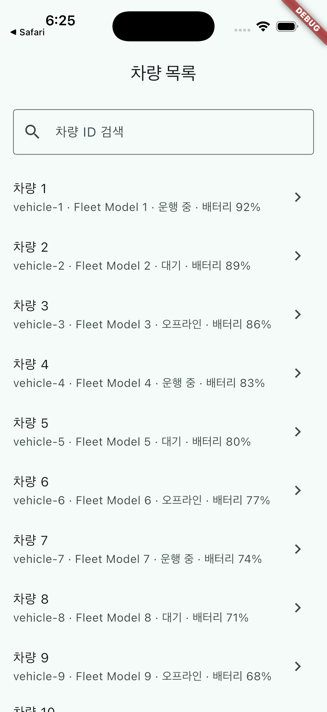
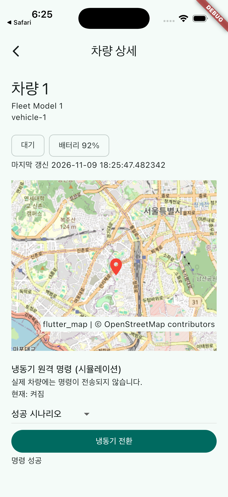

# FleetBridge Flutter

A standalone iOS and Android fleet simulation migrated from [FleetBridge v1.0 Add-to-App](https://github.com/CodingBot000/FleetBridge/releases/tag/v1.0-add-to-app). It simulates ten vehicles, live state and location updates, an OpenStreetMap detail view, and refrigeration command outcomes. No real vehicle or server is contacted.

The original architecture connected a UIKit list and Swift repository to an embedded Flutter detail via MethodChannel. Here both screens use a Riverpod-owned Dart repository and Flutter Navigator. See [migration evidence](docs/migration.md) and [contract](docs/specs/full-flutter-migration.md) for mappings, behavior changes and test correspondence.

## Run

Install Flutter 3.47.9 and platform toolchains, then run `flutter pub get` and `flutter run` on an iOS simulator or Android device. `flutter analyze` and `flutter test` run static analysis and automated checks. CI runs these checks on pull requests to main.

Maps use OpenStreetMap tiles over the network, with visible attribution and an error message. The flutter_map HTTP cache is opportunistic, not an offline guarantee. Commands and connectivity states are simulations.

## Verification

Local Flutter analysis and four automated tests passed. Platform build and execution results are documented below as they are verified. Automated tests cover initial data, lookup, simulation, revision ordering, commands, lifecycle, navigation and a response after screen closure. Network tile error and attribution link behavior remain unverified on devices.

iOS 26.5 Simulator (iPhone 17 Pro): simulator build and launch passed; list, detail map and successful command were observed. Android build and execution are tracked in the pull request.

