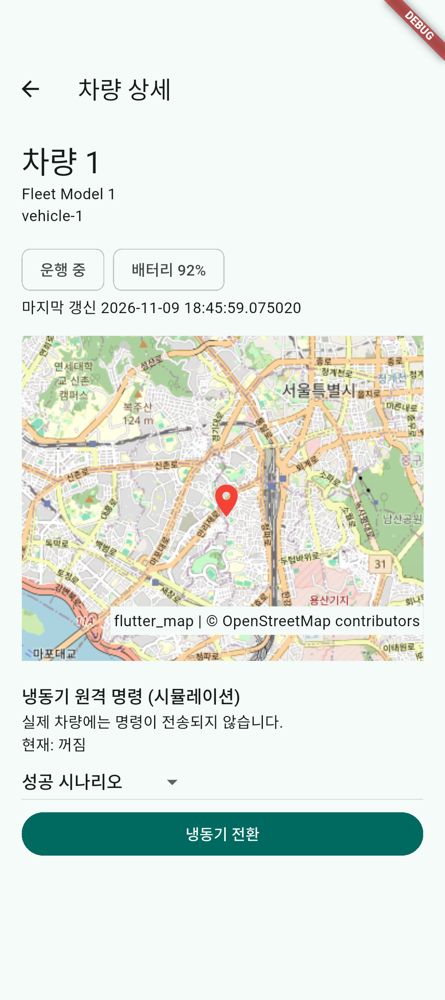

# FleetBridge Flutter

A standalone iOS and Android fleet simulation migrated from [FleetBridge v1.0 Add-to-App](https://github.com/CodingBot000/FleetBridge/releases/tag/v1.0-add-to-app). It simulates ten vehicles, live state and location updates, an OpenStreetMap detail view, and refrigeration command outcomes. No real vehicle or server is contacted.

The original architecture connected a UIKit list and Swift repository to an embedded Flutter detail via MethodChannel. Here both screens use a Riverpod-owned Dart repository and Flutter Navigator. See [migration evidence](docs/migration.md) and [contract](docs/specs/full-flutter-migration.md) for mappings, behavior changes and test correspondence.

## Migration series

This is **Part 2** of a two-stage mobile migration case study. The stages are preserved in separate repositories:

- **Part 1 — [Native iOS + Flutter Add-to-App](https://github.com/CodingBot000/FleetBridge/releases/tag/v1.0-add-to-app)** ([source repository](https://github.com/CodingBot000/FleetBridge)): keep the UIKit host and Swift data source while embedding a Flutter detail screen
- **Part 2 — [Full Flutter Migration](https://github.com/CodingBot000/FleetBridge-Flutter/releases/tag/v1.0-full-flutter)** (this repository): migrate the UI and vehicle business logic to shared Dart code for iOS and Android

The repositories have independent Git histories. See [migration evidence](docs/migration.md) for class mappings, behavioral parity, and intentional differences. Both projects use simulated vehicle data and commands.

## Run

Install Flutter 3.47.9 and platform toolchains, then run `flutter pub get` and `flutter run` on an iOS simulator or Android device. `flutter analyze` and `flutter test` run static analysis and automated checks. CI runs these checks on pull requests to main.

Maps use OpenStreetMap tiles over the network, with visible attribution and an error message. The flutter_map HTTP cache is opportunistic, not an offline guarantee. Commands and connectivity states are simulations.

## Verification

`flutter analyze`, `flutter test` and the PR CI validate static analysis and deterministic tests. Pixel 9 API 36 and iPhone 17 Pro iOS 26.5 emulator/simulator integration tests exercised navigation, command outcomes, pending and offline controls, and state isolation. Android map tiles and marker were observed. Tile errors and retry were tested with injected failures on Android. The attribution tap opened Chrome's first-run screen; the destination page was not verified. Physical devices, real network outages and device background/resume remain unverified. See [migration evidence](docs/migration.md) for comparisons and limits.

[Android command failure](docs/screenshots/android-command-failure.png) · [Android command timeout](docs/screenshots/android-command-timeout.png)
